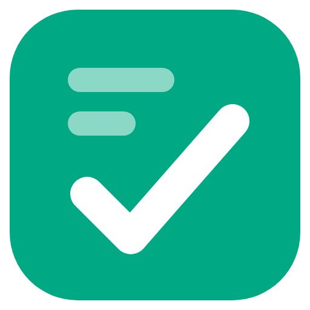
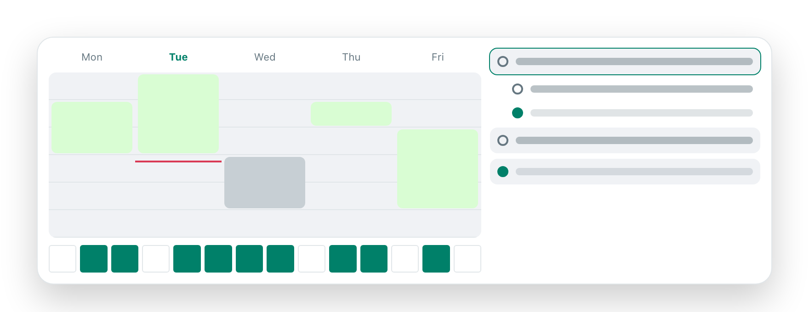

  

<h1 align="center">Jotbit</h1>

<b>Jot down tasks, organize priorities, and track habits.</b>

  Jotbit puts your week planner, to-do list and habit tracker on one simple board. 
  Plan in 30 minute slots, pin it to your desktop and watch your life tree grow.

  <picture>
    <source media="(prefers-color-scheme: dark)" srcset="jotbit-board-dark.png">
    
  </picture>

  <a href="https://jotbit-labs.github.io"><b>jotbit-labs.github.io</b></a>

## One board for your day

- **Week planner:** Drag tasks onto 30 minute slots. Scroll through the week, zoom out to see the whole day.
- **To-do list:** Break tasks into subtasks, give each one its time and a deadline. Done items get a line through them.
- **Habit tracker:** A simple month grid. One click a day keeps the streak going.
- **Pinned to your desktop:** Pin the board behind your windows on the Mac. It stays on every desktop, ready when you need it.
- **Life tree:** A small tree that grows when you tick habits and finish what you planned, and dries out when tasks go overdue.

## Download Jotbit

**Mac** (macOS 12 or later): [download](https://jotbit-labs.github.io/#download). Windows, Android, iPhone and iPad: coming soon.
